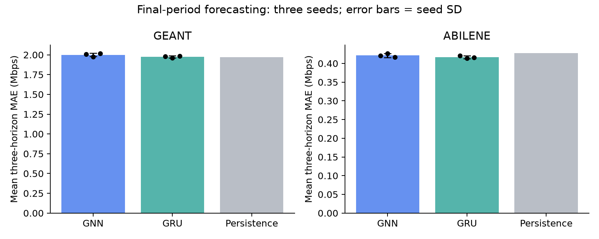
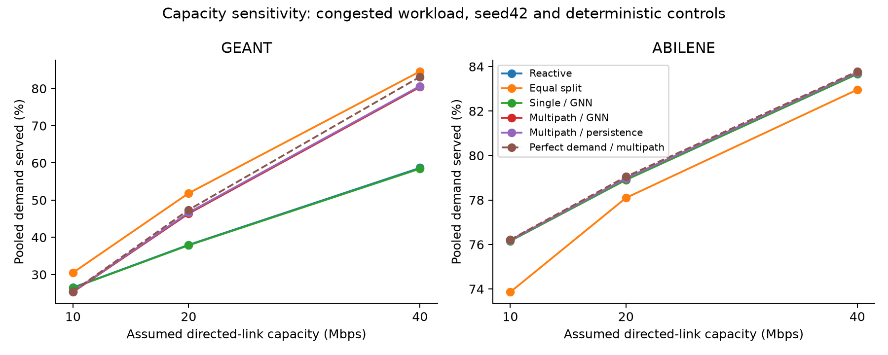
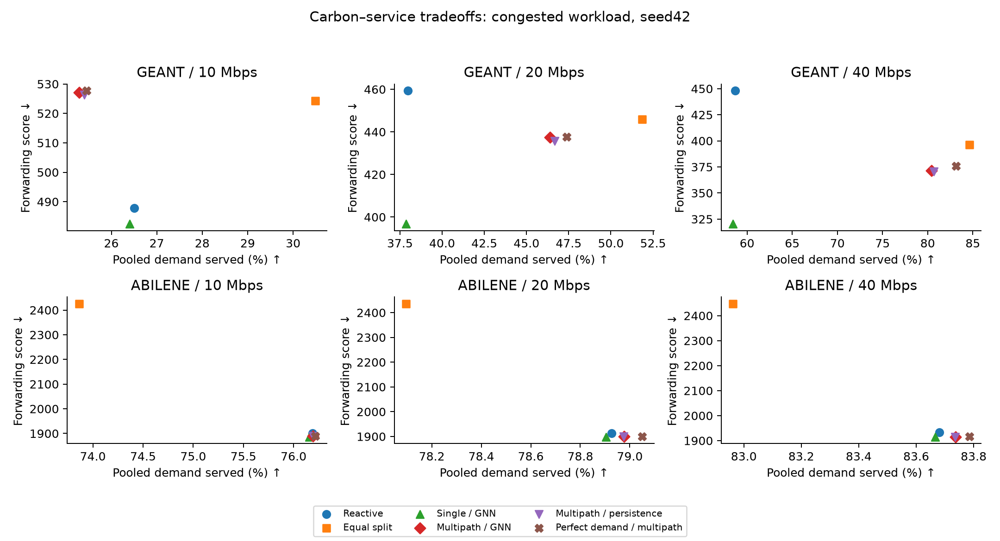

# Evaluating Predictive Carbon-Aware Routing: Forecasting and Multipath Trade-offs on GÉANT and Abilene

**Ashutosh Gupta, Tanay Mohta, Avaneesh Chavan**

**Working manuscript — 27 October 2026.** This replaces the earlier one-seed draft. Primary evidence comes from the final three-check evaluation; earlier inspected campaigns remain supplementary. Affiliation, corresponding-author details and venue formatting remain to be supplied before submission. The proposed title reflects the findings rather than assuming the original GNN hypothesis succeeded.

## Abstract

Carbon-aware routing can lower the carbon intensity attributed to forwarding, but may concentrate traffic on shared links. We examine whether graph-based demand prediction improves this trade-off and whether fractional multipath routing changes the outcome. A reproducible aggregate simulator combines historical GÉANT and Abilene traffic with public European daily and US annual regional electricity carbon data. A compact graph convolution–gated recurrent unit model predicts three demand matrices; matched no-neighbor GRU and persistence controls separate forecasting effects from routing effects. Final validation comprises twelve independently trained checkpoints, seven later test days per network, three workloads, three assumed capacities, and 2,058 paired routing runs, including explicitly future-aware perfect-demand diagnostics. Mean three-horizon forecast error is 1.99965 Mbps for the GNN versus 1.97092 for persistence on GÉANT; on Abilene it is 0.42134 versus 0.41650 for the matched GRU. In congested GÉANT at 40 Mbps, seed-42 carbon multipath increases pooled served demand from reactive routing's 58.672% to 80.412% and lowers the forwarding score from 448.18 to 371.35. At 10 Mbps, however, its three-seed mean has lower service and a higher score than reactive routing. Matched perfect-demand replacement at 10 Mbps produces service gains below 0.7 percentage points. The findings establish conditional routing trade-offs and limited evidence for graph prediction, rather than general GNN superiority or measured emissions reductions.

**Keywords:** carbon-aware routing; traffic engineering; demand forecasting; graph neural networks; multipath routing; trace-driven simulation.

## 1. Introduction

Routing determines which links carry traffic between an origin and destination. A short path can traverse locations with relatively high electricity carbon intensity, while a lower-intensity alternative may share constrained links with other demands. A controller must balance forwarding attribution, served traffic, overload risk and route stability before it knows the next demand matrix exactly.

We evaluate a compact graph neural network (GNN) for short-horizon demand prediction within centralized carbon-aware routing. Holding the service model and inputs fixed, we compare guarded reactive routing, joint single-path selection and fractional multipath selection. Independent training seeds, capacity sensitivity and perfect-demand controls distinguish the predictor's value from routing flexibility and the planner's objective. Three research questions guide the evaluation:

1. **RQ1 — prediction:** Does graph aggregation improve forecasting and routing compared with a matched GRU and persistence across training seeds?
2. **RQ2 — routing:** How do single-path and multipath carbon/service trade-offs change under fixed workload and capacity scenarios?
3. **RQ3 — information:** How much do existing planners benefit when forecast error is removed without changing candidate paths or optimization rules?

The study makes three empirical contributions. First, a common origin–destination (OD) service model compares split and unsplit policies without giving split traffic extra fairness shares. Second, matched predictor and perfect-demand controls separate forecast accuracy from planning objectives. Third, a frozen two-network evaluation documents when multipath improves the carbon/service trade-off and when it regresses. These contributions concern experimental methodology and evidence, rather than invention of predictive carbon routing or graph forecasting. The implementation models centralized decisions relevant to software-defined networking (SDN); it is an aggregate simulation, not a deployed controller or packet-level emulation.

## 2. Related work

CIRo investigates carbon-aware global routing in path-aware networks, including prediction of path carbon characteristics [7]. Our model instead predicts **traffic demand**, while the planner uses current carbon; it does not reproduce CIRo's SCION mechanisms. CATE explores carbon-aware routing with explicit network power considerations [8], motivating the distinction between forwarding-intensity attribution and physical emissions, particularly with substantial idle power. Our score does not estimate device shutdown savings.

SMORE studies semi-oblivious traffic engineering and traffic splitting [9]. We use a small delay-feasible path set and a lexicographic LP, not a reproduction of SMORE. DOTE learns traffic-engineering decisions from historical demand [10], motivating attention to the mismatch between prediction error and routing outcomes; its learned optimizer is not implemented here. Graph convolution [13] and gated recurrence [14] provide architectural precedents. Our local-plus-neighbor aggregation, shared GRU and residual persistence head constitute a compact adaptation, not the original node-classification GCN or a reproduction of another forecasting model.

SNDlib, the GÉANT traffic methodology, ECON-PowerCI, the Abilene collector and EPA provide the data foundations [1–6]. The SNDlib dynamic-data catalog also requests references [11,12]; these are dataset citations, not algorithms we implemented.

## 3. Data and scenario construction

### 3.1 Networks and traffic

GÉANT is the main inter-country scenario. We retain France, Germany, Belgium, Netherlands, Switzerland, Italy, Austria and Luxembourg: eight nodes, eleven physical links and twenty-two directed arcs. SNDlib supplies dynamic 15-minute OD matrices associated with historical GÉANT measurements [1,2]. We use dynamic demand sections, not the topology file's static peak demand table.

Abilene is an intra-country companion with twelve routers, fifteen physical links and thirty directed arcs. Connectivity comes from its trace routing matrix; a Topology Zoo snapshot supplies city coordinates only. The collector's `realOD` fields are NetFlow-derived OD estimates rather than exact counters of all network traffic [5]. We take the first field of each five-column OD block, converting 100-byte-per-five-minute units into decimal Mbps.

Both scenarios retain six directed OD pairs, selected using training mean demand and shortest-route overlap, with alternative delay-feasible routes. A training-fitted scalar makes training p95 shortest-route peak utilization reach 70% of the original 10 Mbps capacity. Per-OD training p95, floored at 0.01, normalizes neural inputs. Pair selection, scalar and normalization remain fixed for later tests and all capacities. Findings concern these selected traffic scenarios, not full-network performance.

Each physical link becomes two independent directed links. Capacities of 10, 20 and 40 Mbps per direction are declared assumptions, not historical measurements. One-way propagation parameters are great-circle distance × 1.3 / 200 km/ms + 0.15 ms per hop. They do not measure packet delay or RTT.

### 3.2 Carbon inputs

ECON-PowerCI provides daily consumption-based European electricity CO₂ intensity accounting for cross-border electricity flows [3,4]. We use its `Value` and retain quality flags, holding each daily value over ninety-six GÉANT bins. The final replay pairs source-labeled 3–9 August 2005 traffic with 3–9 August 2022 country values under a calendar/coverage rule, without selecting favorable contrasts.

The GÉANT source paper states that public traffic timestamps were anonymized [2]. Apparent dates identify positions in the published sequence; calendar/weekday pairing is a **constructed counterfactual**, not historical synchronization or validated seasonal correspondence. The traffic and carbon were not collected together.

Abilene cities are approximately mapped to EPA eGRID2004 subregions [6]. Annual CO₂ generation output rates in lb/MWh are multiplied by 0.45359237 to obtain g/kWh. Rates vary spatially but stay fixed at every five-minute interval. Same-year pairing does not provide hourly grid changes or verify a router's electricity supplier. European consumption-based and US generation-based rates have different accounting boundaries; compare methods within each network rather than absolute scores across networks.

### 3.3 Chronological separation and workloads

| Network | Original training | Original validation | Final later test |
| --- | --- | --- | --- |
| GÉANT | Source labels 4 May 2005 15:00–29 May 10:30 | 29 May 10:45–6 June 17:00 | 3–9 August 2005 |
| Abilene | X01–X02, 1–14 March 2004 | X03, 2–8 April 2004 | X10/X11, 1–7 June 2004 |

Original tests end on 14 June for GÉANT and 15 April for Abilene; later development campaigns also precede the final periods. Final training uses only original train/validation splits. History and labels cannot cross timestamp gaps. Replay begins with twelve historical bins and extends its final forecast labels two bins beyond the replay day.

A GÉANT preflight checks native demand-section availability through initial history and the complete following day. All seven declared days are retained. This addresses an earlier campaign's empty sections without deleting those earlier outcomes. Source archives already existed locally: “fresh test” means no recorded prior routing outcomes on these dates, not never-downloaded files or external preregistration.

The fixed workloads are normal source-scaled demand, 1.6× congested demand, and seeded per-OD 2.5× bursts lasting three bins with event probability 0.08 per bin. Bursts are simulated perturbations of real traffic, generated through the extra label tail. Every paired policy receives identical realized input. Scaling is not refitted at higher capacities; the three capacities do not guarantee light/moderate/heavy operating regimes.

## 4. Prediction and causal decision loop

A node's features are its outgoing OD demands. We concatenate local features with normalized-adjacency neighbor aggregation, apply a learned transform and ReLU, and process twelve bins with a shared 32-unit GRU. A residual head corrects the latest observation to produce three nonnegative matrices, masking inactive ODs. The GNN has 7,672 parameters on GÉANT and 8,324 on Abilene.

Let X_t be the training-normalized demand matrix, A the normalized graph adjacency, and M the active-OD mask. For each observed time step, spatial features are Z_t = ReLU([X_t, A X_t] W_s + b_s). A node-shared GRU encodes the sequence Z_(t−12) through Z_(t−1). Its output head produces a separate correction R_h for each horizon h, giving normalized forecast max(0, X_(t−1) + R_h) multiplied elementwise by M. Multiplying by the frozen per-OD scale restores Mbps. The graph's adjacency is fixed; it is not a learned traffic-dependency graph.

The matched GRU replaces adjacency with identity, preserving architecture and parameter count while removing communication between different nodes. Persistence repeats the latest matrix. Predictors do not take carbon, propagation delay or future traffic as input.

Twelve new checkpoints cover two architectures × two networks × seeds 7, 42 and 123. Adam uses learning rate 0.001, batch size 128, active-pair MAE in Mbps and gradient clipping at norm 1. Validation selects checkpoints. GÉANT permits forty epochs/patience eight; Abilene twenty-five/patience six. A frozen protocol narrative accidentally generalized forty/eight to both networks; the implementation always read correct per-network settings. A separate erratum preserves the wording correction without changing the protocol or outcomes.

For horizon h, margin m_h is the validation 90th percentile of positive underprediction max(actual − predicted, 0), pooled across active pairs. Routing uses predicted demand + m_h. This empirical allowance is not a coverage guarantee under shifted or bursty traffic.

At decision t, causal policies observe traffic only through t−1, predict t through t+2, and commit routes before actual demand at t is revealed. The twelve-bin history spans three hours on GÉANT and one hour on Abilene; prediction offsets are 15/30/45 and 5/10/15 minutes respectively. The current carbon vector is held over the planning horizon. We do not forecast carbon.

## 5. Routing, service and accounting

### 5.1 Shared paths and baseline policies

Each OD has up to three loop-free candidates, bounded by 1.5× shortest configured propagation on GÉANT and 2× on Abilene. The retained sets produce sixty-four and 324 joint single-path assignments. Methods share candidates, inputs, capacity and service allocation within a condition.

The final base comparison contains shortest path, reactive carbon, equal splitting, service-first with GNN/GRU/persistence, carbon multipath with GNN/GRU/persistence, and GNN multipath TE without carbon. Reactive carbon uses latest observed demand, shared reservations and a utilization guard, falling back to lower projected peak if no candidate satisfies it. Elective changes have a 5% improvement threshold and two-bin hold rule, with risk overrides. This is a particular guarded reactive baseline, not every reactive algorithm.

Earlier joint carbon-budget work enumerates assignments with forecast carbon/peak constraints relative to a reactive reference. It remains supplementary; it is not one of the final ten base policies and its development results are not fresh final-test evidence.

### 5.2 Service-first single-path selection

For every assignment and forecast horizon, service-first applies the common max-min allocator. It first maximizes predicted served rate across horizons, then minimizes served-weighted carbon score among assignments within 0.001 of total predicted offered rate of that optimum. Changes and configured delay break subsequent ties. The 0.1% tolerance applies to the forecast objective, not realized test service. Each OD uses one path.

### 5.3 Fractional multipath selection

Let w_fp be the nonnegative fraction of OD f on candidate p, summing to one for each OD. A conservative envelope takes each OD's maximum forecast-plus-margin over three horizons. The free HiGHS LP solver uses ordered objectives:

1. Minimize maximum envelope link utilization, obtaining u*.
2. In carbon mode, minimize forecast-mean offered-traffic-weighted path carbon, with peak bounded by max(0.8, u*) plus solver tolerance.
3. Minimize L1 change from previous fractions while retaining preceding congestion/carbon limits.

The no-carbon TE control holds the minimum-peak limit and minimizes changes without a carbon stage. Equal split uses fixed identical fractions across candidate paths. Every method routes 100% of offered traffic; optimization has no admission/drop variable. The common allocator subsequently determines served rates.

The LP minimizes envelope congestion and linear offered-carbon cost, which differ from realized max-min service and served-weighted score. Perfect forecasts therefore need not improve every reported metric. Fractions are idealized; packet ordering and installed OpenFlow buckets are not tested.

More formally, let e_f be the maximum forecast-plus-margin for OD f over the three horizons and dbar_f its horizon mean. For link capacity C_l and path incidence a_lfp, the first LP minimizes u subject to sum_(f,p) a_lfp e_f w_fp ≤ u C_l and sum_p w_fp = 1. The carbon stage minimizes sum_(f,p) dbar_f q_p w_fp under the fixed peak limit. The last stage minimizes sum_(f,p) |w_fp − wprevious_fp|, preserving earlier objective values within solver tolerance. This ordering avoids selecting a scalar carbon/congestion trade-off weight, but the fixed 0.8 guard still defines an explicit planning preference.

### 5.4 Common service and metrics

Let a_lfp indicate whether path p of OD f uses directed link l. Effective incidence is B_lf = sum_p a_lfp w_fp. Offered link rate is L_l = sum_f B_lf D_f. Equal-rate progressive filling allocates s_f ≤ D_f subject to sum_f B_lf s_f ≤ C_l. Each OD receives one fairness share regardless of subpath count; splitting cannot create extra shares.

**Overload minutes** count bins where any full offered link load exceeds capacity, describing offered pressure rather than packet loss or queue occupancy. Served loads remain feasible. **p95 link utilization** is the percentile over flattened link/bin offered-utilization samples, not over per-bin maxima. **Pooled service** divides total served bytes by total offered bytes. We retain least-served active OD fraction, path changes, redistributed fraction mass and assumed propagation. An OD changes when its L1 fraction change exceeds 10⁻⁶; redistributed mass is half the total L1 change.

For intensity c_v, path attribution is q_p = sum of c_v at forwarding senders, excluding the destination. With bin duration Δ seconds, served path traffic b_ftp = s_ft w_ftp Δ/8 decimal MB. The run score is

\[
F = \frac{\sum_{t,f,p} b_{ftp}q_{pt}}{\sum_{t,f,p} b_{ftp}}.
\]

This is hop-summed intensity attribution weighted by **served** bytes. Without observed energy per byte it is not grams of emitted CO₂. The served-demand mix can change its value, so service must accompany every environmental comparison.

## 6. Three-check validation protocol

The protocol was frozen locally before new training/test outcomes. At 10 Mbps, service-first and carbon multipath run all three seeds for both neural predictors. Capacity comparisons fix seed 42. Perfect-demand controls replace forecasts with actual next-three-bin demand for service-first, carbon multipath and no-carbon multipath, using zero margin and the same current carbon. Their logs explicitly label future knowledge. They are offline diagnostics, not deployable policies or global bounds.

Additional causal zero-margin GNN controls at 10 Mbps isolate forecast replacement from margin removal. At 20/40 Mbps perfect comparisons also remove margins, so those gaps do not isolate prediction accuracy alone. There are twenty-three cases per day/workload at 10 Mbps and thirteen at each larger capacity: (23+13+13) × 7 × 3 × 2 = **2,058 runs**, including 378 future-aware and 1,680 causal runs, over 395,136 replay intervals.

Forecast MAE covers normal source-scaled demand at every final replay-bin start and all horizons. Routing also evaluates congestion/bursts. Forecast spread is sample SD across three seeds. Routing uncertainty uses 2,000 paired bootstrap resamples of seven whole days, averaging seeds within each day. Bins/seeds are not independent extra traffic days. Adjacent-day dependence and multiple comparisons limit inferential strength; intervals are descriptive, not multiplicity-corrected hypothesis tests.

The independent audit checks frozen source/input/checkpoint lineage, validation-only training metadata, case completeness, exact shared inputs, causal/future-aware timestamps, conservation, capacity, max-min fairness certificates, carbon and recomputed metrics. Native float32 offered-byte rounding is explicitly bounded. Forecast caching across capacities asserts historical inputs, but excludes bulk neural inference from recorded decision times; these are not end-to-end deployment timings.

The causal execution order is fixed: obtain the twelve historical matrices; compute forecasts and margins; select paths/fractions using current carbon; commit the routing decision; reveal the next demand; allocate feasible service; and record offered utilization, served bytes, carbon score and changes. Only the explicitly future-aware diagnostic replaces the forecasting step with actual future demand. This separation makes deployment assumptions and offline information advantages visible.

## 7. Results

### 7.1 Training seeds

**Table 1.** Mean three-horizon MAE in Mbps, then mean ± sample SD across three seeds. Lower is better; persistence is deterministic.

| Network | GNN | Matched GRU | Persistence |
| --- | ---: | ---: | ---: |
| GÉANT | 1.99965 ± 0.02174 | 1.97566 ± 0.01296 | 1.97092 |
| Abilene | 0.42134 ± 0.00523 | 0.41650 ± 0.00371 | 0.42746 |

Graph aggregation shows no consistent advantage. All GÉANT GNN seeds have higher MAE than persistence; the mean is about 1.46% worse. Abilene GNN improves on persistence by about 1.43%, but each matched GRU seed has lower error than its corresponding GNN seed. This finding concerns these models, demands and periods, not GNNs universally. Seed-42 retraining reproduces original model tensors exactly for both architectures/networks.



**Figure 1.** Points represent training seeds; error bars are seed SD, not traffic-population confidence intervals.

### 7.2 Reference-capacity routing

**Table 2.** Congested demand at 10 Mbps. Neural service-first/carbon-multipath rows average three seeds. Service pools bytes; score, overload and changes average days.

| Network | Policy | Score ↓ | Served % ↑ | Overload min/day ↓ | Changes/day |
| --- | --- | ---: | ---: | ---: | ---: |
| GÉANT | Shortest path | 680.69 | 18.684 | 1170.00 | 0.00 |
| GÉANT | Reactive carbon | 487.85 | 26.500 | 990.00 | 16.29 |
| GÉANT | Equal split | 524.32 | 30.487 | 927.86 | 6.00 |
| GÉANT | Service-first GNN | 482.63 | 26.408 | 1015.71 | 19.24 |
| GÉANT | Carbon multipath GNN | 528.02 | 25.254 | 970.71 | 100.90 |
| GÉANT | Carbon multipath GRU | 527.14 | 25.239 | 970.71 | 100.48 |
| GÉANT | Carbon multipath persistence | 526.27 | 25.408 | 964.29 | 102.43 |
| Abilene | Shortest path | 2150.70 | 76.046 | 75.00 | 0.00 |
| Abilene | Reactive carbon | 1901.67 | 76.190 | 67.86 | 9.29 |
| Abilene | Equal split | 2426.04 | 73.862 | 330.71 | 6.00 |
| Abilene | Service-first GNN | 1885.89 | 76.153 | 73.57 | 10.10 |
| Abilene | Carbon multipath GNN | 1888.94 | 76.189 | 69.29 | 166.19 |
| Abilene | Carbon multipath GRU | 1888.57 | 76.187 | 69.29 | 157.14 |
| Abilene | Carbon multipath persistence | 1889.39 | 76.191 | 69.29 | 172.86 |

At 10 Mbps, congested GÉANT carbon multipath has higher score and lower pooled service than reactive carbon, despite lower overload duration. Its paired day-mean score difference is +40.16 with descriptive interval [24.35, 54.01], and overload difference −19.29 minutes/day [−30.00, −8.57]. The day-mean service-fraction difference is −0.00837 [−0.02542, 0.00958]; this differs from the pooled −1.246 percentage points in Table 2. Severe saturation makes this a stress scenario rather than representative operational efficiency.

Abilene carbon multipath lowers score by 12.73 [−25.29, −4.52] but leaves pooled service essentially unchanged and substantially increases route changes. Persistence yields nearly identical service. Equal split serves more GÉANT traffic at higher score, but performs poorly on Abilene. No policy dominates across networks and metrics.

Normal/bursty results are also retained. At 10 Mbps GÉANT GNN multipath serves 37.664% versus reactive 33.660% under normal traffic, raising score 463.28 → 469.23; under bursts it serves 30.171% versus 28.627%, raising score 469.71 → 495.54. Abilene's corresponding normal service is 77.929% versus 77.866%, with score 1894.91 versus 1907.71; burst service is 78.032% versus 78.042%, with score 1891.18 versus 1927.39. Complete condition tables retain all policies and workloads.

### 7.3 Capacity sensitivity

**Table 3.** Congested traffic, seed 42 fixed across capacities. Cells are pooled served % / mean score. Seed-specific 10 Mbps values intentionally differ from Table 2's three-seed averages.

| Network / Mbps | Reactive | Equal split | Service-first GNN | Multipath GNN | Multipath persistence |
| --- | ---: | ---: | ---: | ---: | ---: |
| GÉANT / 10 | 26.500 / 487.85 | 30.487 / 524.32 | 26.401 / 482.45 | 25.288 / 527.11 | 25.408 / 526.27 |
| GÉANT / 20 | 37.983 / 459.40 | 51.862 / 445.89 | 37.860 / 396.79 | 46.380 / 437.48 | 46.658 / 435.74 |
| GÉANT / 40 | 58.672 / 448.18 | 84.611 / 396.27 | 58.453 / 320.39 | 80.412 / 371.35 | 80.665 / 370.66 |
| Abilene / 10 | 76.190 / 1901.67 | 73.862 / 2426.04 | 76.155 / 1885.90 | 76.191 / 1889.34 | 76.191 / 1889.39 |
| Abilene / 20 | 78.927 / 1913.10 | 78.096 / 2436.15 | 78.904 / 1898.16 | 78.977 / 1899.48 | 78.976 / 1899.46 |
| Abilene / 40 | 83.680 / 1933.22 | 82.963 / 2448.07 | 83.666 / 1914.77 | 83.737 / 1915.52 | 83.736 / 1915.50 |

At 40 Mbps GÉANT carbon multipath raises pooled service by 21.740 percentage points versus reactive and lowers score by about 17.14%; overload falls 825.00 → 587.14 minutes/day. The paired **day-mean** service gain is 21.576 percentage points [17.487, 25.327], and score difference −76.83 [−105.95, −42.38]. These are substantial conditional gains, but persistence is slightly better and equal split serves more with higher score. The gains cannot be attributed uniquely to graph prediction.

On Abilene, learned carbon multipath differs from reactive by only about 0.001–0.057 pooled percentage points across these congested capacities. Large localized loads persist: normal 10 Mbps reactive routing serves all demand on five days, while 2 and 3 June contain concentrated overload. GÉANT normal demand also has peaks far above assumed capacity. We retain these source-derived loads without clipping or refitting scaling; larger capacity does not guarantee an uncongested test.

The matched no-carbon TE control makes the objective trade-off explicit. At GÉANT 40 Mbps, seed-42 TE serves 83.472% with score 398.81, versus carbon multipath's 80.412% and 371.35. At Abilene 10 Mbps, TE serves 76.449% with score 2054.81, versus the seed-42 carbon variant's 76.191% and 1889.34. Maximizing load balance and reducing carbon attribution are therefore different objectives; neither can be assessed by a single combined “improvement” claim.



**Figure 2.** Congested pooled service, seed 42. Dashed perfect-demand controls are offline diagnostics and also remove margins at higher capacities.



**Figure 3.** Congested trade-offs; higher service and lower score are preferable. Axes vary by panel; US/European absolute score magnitudes are not directly comparable.

### 7.4 Perfect-demand diagnostic

**Table 4.** Matched forecast replacement at 10 Mbps: causal seed-42 and perfect controls both use zero margin and identical planners. Values are causal → perfect. The diagnostic knows the next three bins, not only the current bin.

| Network / workload / planner | Score | Pooled served % | Overload min/day |
| --- | ---: | ---: | ---: |
| GÉANT / normal / service-first | 424.02 → 424.68 | 33.521 → 33.720 | 938.57 → 915.00 |
| GÉANT / normal / multipath | 466.74 → 467.97 | 37.682 → 38.357 | 921.43 → 895.71 |
| GÉANT / congested / service-first | 479.85 → 485.02 | 26.328 → 26.513 | 1058.57 → 975.00 |
| GÉANT / congested / multipath | 523.66 → 527.76 | 25.217 → 25.453 | 1017.86 → 953.57 |
| GÉANT / bursty / service-first | 454.85 → 459.59 | 28.440 → 28.730 | 1035.00 → 972.86 |
| GÉANT / bursty / multipath | 491.68 → 496.39 | 30.036 → 30.673 | 1009.29 → 932.14 |
| Abilene / normal / service-first | 1894.75 → 1894.44 | 77.849 → 77.903 | 62.14 → 62.14 |
| Abilene / normal / multipath | 1894.95 → 1895.45 | 77.931 → 77.998 | 61.43 → 61.43 |
| Abilene / congested / service-first | 1886.51 → 1886.65 | 76.142 → 76.204 | 77.86 → 70.00 |
| Abilene / congested / multipath | 1888.29 → 1889.57 | 76.180 → 76.216 | 70.00 → 67.86 |
| Abilene / bursty / service-first | 1894.42 → 1901.91 | 78.002 → 78.186 | 97.14 → 76.43 |
| Abilene / bursty / multipath | 1890.91 → 1898.33 | 78.022 → 78.165 | 87.86 → 71.43 |

Forecast replacement improves pooled service by only 0.185–0.675 percentage points for GÉANT and 0.036–0.184 for Abilene. It often lowers overload but usually raises the served-weighted score. Forecast error is therefore not the sole limitation within these planners at reference capacity. Saturation, candidate paths, envelope construction and objective mismatch remain plausible constraints. This diagnostic neither proves no better algorithm exists nor bounds improvements from a different optimizer, fairness rule or regime.

## 8. Discussion and limitations

The evidence supports a paper about **when prediction and route flexibility help**, rather than a GNN that uniformly beats baselines. Graph aggregation is not consistently better than simpler predictors. Multipath materially improves some GÉANT capacity scenarios, but its carbon/service/churn relationship depends on the operating regime. Small perfect-demand gains suggest limited benefit from forecast replacement alone within the current reference-capacity planners.

Seven adjacent days and three seeds provide narrow evidence. Temporal dependence and multiple comparisons constrain intervals. Six selected ODs, small candidate sets, shared model parameters and uniform assumed capacities limit applicability. Availability checks establish that demand sections exist, not that sampled/inferred OD values are error-free. Concentrated Abilene loads and shifted GÉANT demand affect pooled results; silently removing them would change the experiment.

Carbon is geographically coarse, temporally mismatched or annual, and differs in accounting basis. The score omits measured energy, idle power, equipment heterogeneity and embodied emissions, and can change with served-demand composition. No physical CO₂-saving claim follows. The fluid allocator excludes packet queues, TCP, loss, reordering, controller installation and measured latency. Cached timing cannot establish production controller performance. A packet-level or operational validation would require a separately verified emulator/testbed experiment.

Potential future work includes routing-aligned objectives, broader OD coverage, observed energy coefficients and additional independently reserved periods. These are future experiments, not reported results. More elaborate learning should address an identified limitation rather than be added solely to obtain favorable scores.

## 9. Reproducibility and supplementary evidence

The independent audit passed all **2,058 runs, 395,136 intervals and twelve checkpoints**, including 378 explicitly future-aware diagnostics. Primary evidence is under `results/final-validation-20261027/`: frozen protocol/plan, source/input/model hashes, summary CSV, per-horizon errors, day-cluster intervals, perfect-demand comparisons, figures and `AUDIT.json`. Twelve checkpoints and validation-only training records are under `artifacts/final-validation/`. Detailed logs and third-party bytes remain local and Git-ignored; preparation commands, source URLs and hashes support regeneration. Redistribution rights for every third-party input have not been asserted. `datasets/` collects local originals and readable previews.

```powershell
.\.venv\Scripts\python.exe -m carbonroute.final_validation
.\.venv\Scripts\python.exe scripts/verify_final_validation.py results/final-validation-20261027
.\.venv\Scripts\python.exe scripts/report_final_validation.py results/final-validation-20261027
```

The recorded environment is Python 3.12.14, NumPy 2.5.4, pandas 3.0.6, SciPy 1.18.1 and CPU PyTorch 2.14.1. No paid API, GPU, Linux VM or live feed is required. See [FINAL_VALIDATION.md](FINAL_VALIDATION.md) and [complete findings](../results/final-validation-20261027/FINDINGS.md). The three figures have standalone PDF counterparts for typesetting.

Earlier evidence remains separate: the 495-run GÉANT reference, 42-run Abilene pilot, joint-budget development comparisons, twelve-model/630-run training follow-up, 336-run service-first campaign and 462-run multipath campaign. The training follow-up has three GÉANT days with empty native sections and undefined scores; they are retained and limited, not pooled into the final test. Earlier multipath improved normal GÉANT but lost some congested Abilene service. Methods, failed availability preflight and negative outcomes remain in [FOLLOWUP_STUDY.md](FOLLOWUP_STUDY.md), [JOINT_SELECTOR.md](JOINT_SELECTOR.md), [TRADEOFF_STUDY.md](TRADEOFF_STUDY.md), [SERVICE_FIRST_STUDY.md](SERVICE_FIRST_STUDY.md) and [MULTIPATH_STUDY.md](MULTIPATH_STUDY.md). Previously inspected periods are not independent final-test replications.

## 10. Conclusion

Graph-based demand prediction does not establish a consistent advantage over matched simpler predictors in these GÉANT and Abilene scenarios. Multipath changes carbon/service trade-offs substantially when assumed GÉANT capacity permits useful redistribution, but does not dominate across capacities, networks and objectives. Matched perfect-demand controls yield small reference-capacity service gains while often changing carbon attribution unfavorably. The contribution is a reproducible evaluation of prediction limits, capacity sensitivity and routing trade-offs, rather than a generally superior GNN policy or measured emissions reductions.

## References

Full records are maintained in [REFERENCES.bib](REFERENCES.bib). Dataset citations establish provenance rather than reproduction of their authors' algorithms.

1. S. Orlowski, M. Pióro, A. Tomaszewski and R. Wessäly. “SNDlib 1.0—Survivable Network Design Library.” *Networks* 55(3), 276–286, 2010. [DOI](https://doi.org/10.1002/net.20371).
2. S. Uhlig, B. Quoitin, J. Lepropre and S. Balon. “Providing Public Intradomain Traffic Matrices to the Research Community.” *ACM SIGCOMM CCR* 36(1), 83–86, 2006. [DOI](https://doi.org/10.1145/1111322.1111341).
3. S. Zhang et al. “A near-real time daily European Power Consumption and Carbon Intensity Dataset (ECON-PowerCI).” *Scientific Data* 12, 1693, 2025. [Publisher](https://www.nature.com/articles/s41597-025-05978-7).
4. S. Zhang. *ECON-PowerCI_2015_2024*, version 2, Zenodo, 2025. [Dataset](https://doi.org/10.5281/zenodo.15987717).
5. Y. Zhang. *Abilene Traffic Matrices: Source Readme and Collection Methodology*. 2004 data. [Collector](https://www.cs.utexas.edu/~yzhang/research/AbileneTM/readme.txt).
6. US EPA. *Historical eGRID Data: 2004 Aggregation Workbook*. [Official archive](https://www.epa.gov/egrid/historical-egrid-data).
7. S. Tabaeiaghdaei, S. Scherrer, J. Kwon and A. Perrig. “Carbon-Aware Global Routing in Path-Aware Networks.” *ACM e-Energy*, 2023. [DOI](https://doi.org/10.1145/3575813.3595192).
8. S. El-Zahr, P. Gunning and N. Zilberman. “Exploring the Benefits of Carbon-Aware Routing.” *Proceedings of the ACM on Networking* 1(CoNEXT3), article 20, 2023. [DOI](https://doi.org/10.1145/3629165).
9. P. Kumar et al. “Semi-Oblivious Traffic Engineering: The Road Not Taken.” *USENIX NSDI*, 157–170, 2018. [Proceedings](https://www.usenix.org/conference/nsdi18/presentation/kumar).
10. Y. Perry et al. “DOTE: Rethinking (Predictive) WAN Traffic Engineering.” *USENIX NSDI*, 1557–1581, 2023. [Proceedings](https://www.usenix.org/conference/nsdi23/presentation/perry).
11. F. Idzikowski et al. “Dynamic routing at different layers in IP-over-WDM networks—Maximizing energy savings.” *Optical Switching and Networking*, 2011. [SNDlib record](https://sndlib.put.poznan.pl/IdzikowskiOrlowskiRaackWoesnerWolisz2010b.bib).
12. A. M. C. A. Koster, M. Kutschka and C. Raack. “Towards Robust Network Design using Integer Linear Programming Techniques.” *Next Generation Internet Conference*, 2010. [DOI](https://doi.org/10.1109/NGI.2010.5534462).
13. T. N. Kipf and M. Welling. “Semi-Supervised Classification with Graph Convolutional Networks.” *ICLR*, 2017. [Author preprint](https://arxiv.org/abs/1609.02907).
14. K. Cho et al. “Learning Phrase Representations using RNN Encoder-Decoder for Statistical Machine Translation.” *EMNLP*, 2014. [Author preprint](https://arxiv.org/abs/1406.1078).
