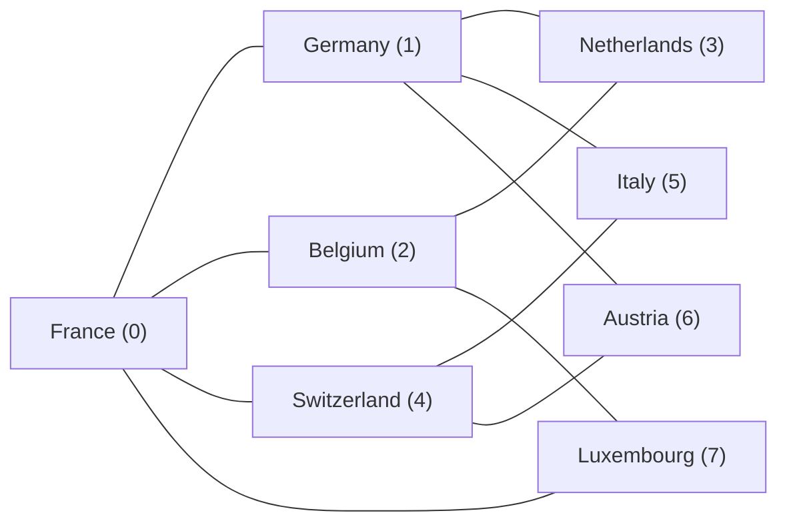
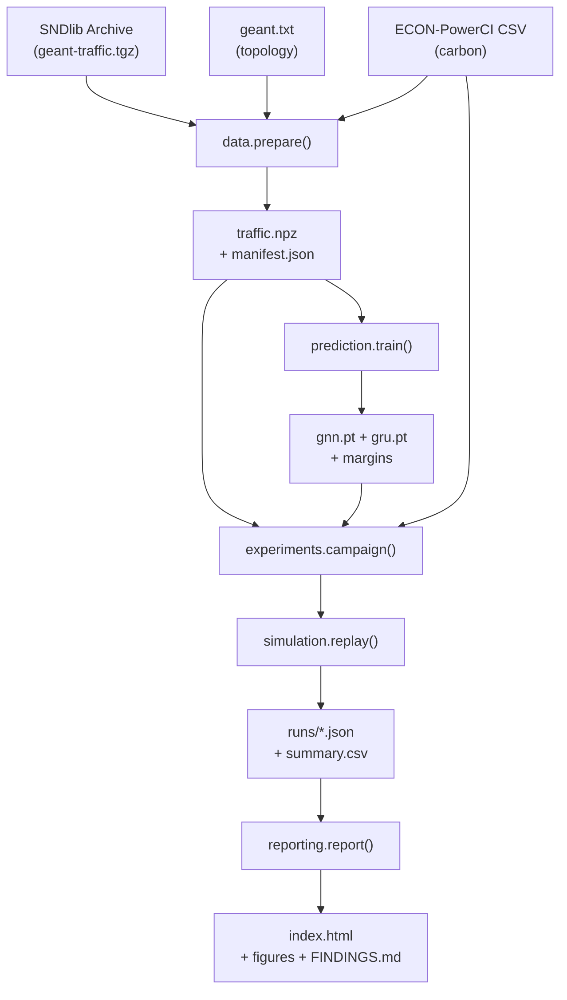

# 🎓 Complete Project Explanation — GÉANT Predictive Carbon-Aware Routing

> **Title:** Graph Neural Network Driven Predictive Carbon-Aware Routing with Congestion Safeguards in Software-Defined Networks

> **Team:** Ashutosh Gupta, Tanay Mohta, Avaneesh Chavan

---

## 1. THE PROBLEM — What Are We Solving?

### 1.1 Background: How the Internet Routes Traffic

In traditional networks, traffic travels along **shortest paths** — the fastest route from source to destination. This is simple and effective for performance, but it ignores the **environmental cost** of routing.

### 1.2 The Carbon Problem

Different countries generate electricity with different carbon intensities:
- **France** (nuclear-heavy) → low carbon intensity
- **Germany** (coal/gas mix) → higher carbon intensity
- **Poland** → very high carbon intensity

Every router that forwards your data **consumes electricity**. If your packet hops through a "dirty-grid" country, it has a higher carbon footprint. **Carbon-aware routing** tries to route traffic through countries with **cleaner electricity grids**.

### 1.3 The Conflict: Carbon vs. Congestion

Here's the catch: if everyone's traffic is diverted to "green" paths, those links get **overloaded** (congestion). This is the core tension:

```
                    ┌──────────────────────────┐
                    │      THE TRADE-OFF        │
                    ├──────────────────────────┤
                    │ Low Carbon → Congestion ↑ │
                    │ Low Congestion → Carbon ↑ │
                    └──────────────────────────┘
```

### 1.4 The Research Question

> **"When cleaner routes share constrained links, can short-horizon GNN traffic prediction and a validation-calibrated error margin reduce overload while retaining lower modeled forwarding carbon intensity?"**

In simpler terms: **Can we predict future traffic using a Graph Neural Network, and use those predictions to pick routes that are both green AND not congested?**

---

## 2. THE APPROACH — Software-Defined Networking (SDN)

### 2.1 Why SDN?

In an SDN, a **central controller** makes all routing decisions. Unlike traditional distributed routing where each router decides independently, the SDN controller:
- Has a **global view** of the entire network
- Can dynamically **change routes** as conditions change
- Can incorporate **carbon data** and **traffic predictions** into decisions

### 2.2 Our System Pipeline

```
┌─────────────────────────────────────────────────────────────┐
│                    SYSTEM PIPELINE                           │
│                                                             │
│  Historical Traffic   +   Country Carbon Data               │
│  (SNDlib GÉANT 2005)      (ECON-PowerCI 2015-2024)         │
│         │                        │                          │
│         v                        v                          │
│  ┌──────────────┐    ┌───────────────────┐                  │
│  │ Traffic Data  │    │ Daily Carbon      │                  │
│  │ 15-min bins   │    │ Intensity (8      │                  │
│  │ 8×8 OD matrix │    │ countries)        │                  │
│  └──────┬───────┘    └────────┬──────────┘                  │
│         │                     │                              │
│         v                     v                              │
│  ┌──────────────────────────────────┐                       │
│  │     GCN-GRU Predictor            │                       │
│  │  (predicts 15/30/45 min ahead)   │                       │
│  │  + Validation Error Margin       │                       │
│  └──────────────┬───────────────────┘                       │
│                 v                                            │
│  ┌──────────────────────────────────┐                       │
│  │  Carbon-Aware Path Planner       │                       │
│  │  • Shared capacity reservations  │                       │
│  │  • Hysteresis (route stability)  │                       │
│  │  • Utilization guards (80% cap)  │                       │
│  └──────────────┬───────────────────┘                       │
│                 v                                            │
│  ┌──────────────────────────────────┐                       │
│  │     Causal Replay Simulation     │                       │
│  │  (no peeking at future data!)    │                       │
│  └──────────────┬───────────────────┘                       │
│                 v                                            │
│  ┌──────────────────────────────────┐                       │
│  │  Results, Metrics, HTML Viewer   │                       │
│  └──────────────────────────────────┘                       │
└─────────────────────────────────────────────────────────────┘
```

---

## 3. THE NETWORK — GÉANT Topology

### 3.1 Eight-Node Subgraph

We use 8 real nodes from the GÉANT European research network, connected by 11 physical links (= 22 directed arcs):

| Index | Node ID  | Country      | Carbon Code |
|-------|----------|--------------|-------------|
| 0     | fr1.fr   | France       | FR          |
| 1     | de1.de   | Germany      | DE          |
| 2     | be1.be   | Belgium      | BE          |
| 3     | nl1.nl   | Netherlands  | NL          |
| 4     | ch1.ch   | Switzerland  | CH          |
| 5     | it1.it   | Italy        | IT          |
| 6     | at1.at   | Austria      | AT          |
| 7     | lu1.lu   | Luxembourg   | LU          |



### 3.2 Network Parameters

| Parameter | Value | Meaning |
|-----------|-------|---------|
| Capacity per directed link | 10 Mbps | Maximum traffic each direction |
| Propagation delay | `haversine_km × 1.3 / 200 + 0.15 ms` | Fiber speed + processing |
| Candidate paths per OD pair | Up to 3 | Loop-free shortest paths |
| Delay bound | 1.5× shortest path delay | Paths too long are rejected |

> [!IMPORTANT]
> These are **experimental assumptions**, not actual measured GÉANT values. The project is a **simulation**, not a deployment on real infrastructure.

---

## 4. THE DATA

### 4.1 Traffic Data — SNDlib

- **Source:** SNDlib GÉANT dynamic traffic archive
- **Resolution:** 15-minute intervals (each called a "bin")
- **Format:** 8×8 Origin-Destination (OD) matrices in Mbps
- **Amount used:** 3,972 matrices from the first 42 calendar days (~May–June 2005)
- **6 active OD pairs chosen:** IT→NL, IT→FR, DE→BE, NL→FR, NL→IT, CH→DE

**Chronological split** (no future leakage!):

| Split | Row Range | Windows | Purpose |
|-------|-----------|---------|---------|
| Training | 0–2,382 | 2,369 | Train the GNN |
| Validation | 2,383–3,176 | 780 | Tune hyperparams, calibrate margin |
| Test | 3,177–3,971 | 781 | Final held-out evaluation |

### 4.2 Carbon Data — ECON-PowerCI

- **Source:** Zenodo public dataset (free download)
- **Coverage:** 35 European countries, daily, 2015–2024
- **Unit:** kg CO₂/MWh (= g CO₂/kWh) — consumption-based
- **Years used:** 2022, 2023, 2024 (Luxembourg missing before June 2021)

### 4.3 The Temporal Mismatch (Critical to Understand!)

> [!WARNING]
> Traffic is from **2005**, carbon data starts in **2015**. They are NOT simultaneous measurements!

This is a **constructed counterfactual scenario**: "What if this 2005 traffic pattern had been routed using the electricity carbon intensities of 2022/2023/2024?" The pairing uses **same-weekday, nearest-date matching** within 3 weeks. This is explicitly **NOT** a claim that we observed both simultaneously.

---

## 5. THE GNN MODEL (GCN-GRU)

### 5.1 Architecture

```
Input: 12 historical 8×8 OD matrices (3 hours of history)
                    │
                    v
    ┌───────────────────────────────┐
    │ Graph Convolution (GCN) Layer │
    │  • Normalized adjacency A     │
    │  • Self-loops: A_norm =       │
    │    D^(-½)(A+I)D^(-½)          │
    │  • Concatenate: [local, Ax]   │
    │  • Linear(16 → 32) + ReLU     │
    └───────────────┬───────────────┘
                    │
                    v
    ┌───────────────────────────────┐
    │  GRU (Gated Recurrent Unit)   │
    │  • 32 hidden units            │
    │  • Shared across all 8 nodes  │
    │  • Processes 12-step sequence │
    └───────────────┬───────────────┘
                    │
                    v
    ┌───────────────────────────────┐
    │    Residual Prediction Head   │
    │  • Linear(32 → 3×8)          │
    │  • Adds correction to last   │
    │    observation (persistence)  │
    │  • Clamp ≥ 0, mask inactive  │
    └───────────────┬───────────────┘
                    │
                    v
    Output: 3 future 8×8 OD matrices
    (15, 30, 45 minutes ahead)
```

### 5.2 Key Design Choices

| Choice | Value | Why |
|--------|-------|-----|
| Parameters | 7,672 | Small enough for CPU training |
| Hidden size | 32 | Sufficient for 8-node graph |
| Lookback | 12 bins = 3 hours | Captures daily patterns |
| Horizon | 3 bins = 45 minutes | Short-term prediction |
| Training | Adam, lr=0.001, batch 128 | Standard settings |
| Epochs | Up to 40, patience 8 | Early stopping |
| Loss | Active-pair MAE in Mbps | Directly meaningful |
| Seed | 42 | Reproducibility |

### 5.3 The Validation-Calibrated Safety Margin

This is a **key innovation**. The GNN will sometimes **underpredict** traffic. If the planner trusts the prediction and the actual traffic is higher, links get overloaded.

**Solution:** After training, compute the **90th percentile of positive underprediction** on validation data:

```
margin_h = P90 of max(actual_h − predicted_h, 0)  across all validation windows
```

The planner then checks: `predicted + margin` when evaluating capacity feasibility. This is a **conservative buffer** — it makes the planner more cautious, accepting slightly worse carbon scores to avoid congestion.

### 5.4 Comparison Models

| Model | Parameters | Difference |
|-------|-----------|------------|
| **GCN-GRU** (proposed) | 7,672 | Uses graph adjacency for neighbor info |
| **Matched GRU** | 7,672 | Same architecture but identity adjacency (no graph info) |
| **Persistence** | 0 | Just repeats the last observation |

---

## 6. THE ROUTING ALGORITHM

### 6.1 Seven Policies Compared

| # | Policy | Demand Info | Objective |
|---|--------|-------------|-----------|
| 1 | **Shortest Path** | None | Fixed minimum delay routes |
| 2 | **Reactive Carbon** | Last observed bin | Minimize carbon using current demand |
| 3 | **Predictive TE** | GNN forecast | Minimize peak utilization (no carbon) |
| 4 | **Predictive Carbon** (proposed) | GNN forecast + margin | Minimize carbon with forecast-aware guards |
| 5 | **Persistence Carbon** | Persistence + margin | Same as #4 but with trivial predictor |
| 6 | **No Margin** | GNN forecast (raw) | Proposed without safety margin |
| 7 | **No Hysteresis** | GNN forecast + margin | Proposed without route stability |

### 6.2 The Decision Algorithm (Step by Step)

At each 15-minute bin `k`:

```
1. OBSERVE: Get traffic history through bin k-1 (one-bin lag)

2. PREDICT: GNN produces forecasts for bins k, k+1, k+2
   Add safety margin: conservative_forecast = forecast + margin

3. FOR EACH active OD pair (in descending demand order):
   a. Remove this pair's current reservation from projected loads
   b. For each candidate path (up to 3):
      - Project link loads if this path is chosen
      - Check: any link on THIS path > 80% utilization? → infeasible
      - If feasible: compute carbon cost = Σ(CI at each forwarding node)
   c. Among feasible paths:
      - Carbon policies: pick lowest carbon cost
      - Predictive TE: pick lowest max utilization
   d. Apply HYSTERESIS guards:
      - Need ≥5% improvement to switch
      - Must hold current path for ≥2 bins
      - EXCEPT if current path has capacity risk → override
   e. Add selected path's reservation back to loads

4. REVEAL actual demand for bin k (AFTER routes are committed)

5. ALLOCATE served rates using progressive filling
   (deterministic max-min fair sharing at bottleneck links)

6. RECORD everything: offered/served rates, utilization, carbon, etc.
```

### 6.3 Shared Reservations — Preventing Double-Booking

> [!IMPORTANT]
> When evaluating a replacement route for pair `i`, the planner first **removes** pair `i`'s old reservation. After choosing, it **immediately adds** the new reservation. This prevents multiple pairs from all claiming the same slack capacity.

### 6.4 The Joint Carbon-Budgeted Selector (Advanced Extension)

An experimental extension (`BudgetPlanner`) evaluates **all possible route combinations simultaneously** (64 combinations for 6 pairs × 2 paths each):

- Runs a reactive carbon planner internally as a **reference**
- Sets a **carbon budget** = reactive carbon cost × (1 + budget_fraction)
- Among assignments within budget, picks the one with **lowest peak utilization**
- Guarantees carbon cost never exceeds the reactive baseline (at budget_fraction=0)

---

## 7. THE SIMULATION ENGINE

### 7.1 Causal Replay — No Cheating!

The simulation enforces **strict causality**:
- The predictor NEVER sees future traffic
- The planner NEVER sees future carbon values
- Routes are committed BEFORE the actual demand is revealed
- Carbon is only the current day's value, held constant

### 7.2 Service Model — Progressive Filling

When links are overloaded, not all traffic can be served. The `progressive_fill` algorithm:
1. All flows start at rate 0
2. Increase all active flows equally
3. When a flow reaches its demand OR a link saturates → freeze that flow
4. Continue until all flows are frozen

This is a **deterministic fluid max-min approximation**, NOT TCP or packet-level simulation.

### 7.3 Carbon Accounting

```
For each served flow:
   served_MB = served_rate_Mbps × 900 seconds / 8
   path_cost = Σ(carbon_intensity at each forwarding node along the path)

Forwarding Score = Σ(served_MB × path_cost) / Σ(served_MB)
```

> [!NOTE]
> The forwarding score is **NOT grams of CO₂ emitted**. It's a normalized intensity metric under an equal-energy-per-hop convention. It's a **relative comparison tool**, not an absolute measurement.

---

## 8. EXPERIMENT DESIGN

### 8.1 The Full Campaign: 495 Runs

```
5 test days × 3 carbon years × 3 workloads × (7 delayed + 4 immediate) policies
= 5 × 3 × 3 × 11 = 495 runs (each run = 96 bins = 1 day)
```

### 8.2 Three Workload Scenarios

| Scenario | Factor | Description |
|----------|--------|-------------|
| **Normal** | 1.0× | Original scaled traffic |
| **Congested** | 1.6× | Traffic multiplied by 1.6 |
| **Bursty** | 1.0× + bursts | Normal + random 2.5× spikes (8% probability, 3 bins each) |

### 8.3 Observation Delay Sensitivity

| Delay | What policies see | Purpose |
|-------|-------------------|---------|
| **1-bin lag** (primary) | History through bin k-1 | Tests prediction advantage |
| **Immediate** (sensitivity) | History through bin k | Tests if prediction matters when info is current |

---

## 9. KEY RESULTS

### 9.1 Forecast Accuracy

| Model | Test MAE (Mbps) | Interpretation |
|-------|-----------------|----------------|
| GCN-GRU | 0.4893 | Graph aggregation didn't help here |
| Matched GRU | 0.4834 | Slightly better without graph! |
| Persistence | 0.4858 | Just repeating last observation is competitive |

> [!WARNING]
> The GNN does NOT outperform simpler methods on forecast accuracy in this experiment. This is an honest finding, not a failure to report.

### 9.2 Main Results — Congested Workload, One-Bin Lag

| Policy | Carbon Score ↓ | Served % ↑ | Overload min/day ↓ | Changes/day |
|--------|---------------|-----------|-------------------|-------------|
| Shortest Path | 419.36 | 91.22% | 165 | 0.0 |
| Reactive Carbon | 323.83 | 91.89% | 126 | 19.4 |
| Predictive TE | 342.40 | 92.18% | 108 | 8.8 |
| **Proposed GCN-GRU** | **333.18** | **91.92%** | **114** | **18.2** |
| Persistence+safeguards | 338.58 | 91.98% | 114 | 23.0 |
| Without margin | 321.30 | 91.88% | 129 | 17.0 |
| Without hysteresis | 332.23 | 91.92% | 114 | 18.6 |

### 9.3 What the Results Show

**What works:**
- ✅ Prediction reduces overload from 126 → 114 min/day (vs. reactive carbon)
- ✅ The safety margin is the key mechanism (without it: 129 min/day)
- ✅ Predictive TE achieves lowest overload (108 min/day)

**What doesn't:**
- ❌ Carbon score gets worse: 333.18 vs. 323.83 (the margin is conservative)
- ❌ Persistence achieves the same 114 min/day → the GNN component isn't proven superior
- ❌ With immediate observation, the prediction advantage disappears

**Honest conclusion:** *The safeguards (margin + reservations + hysteresis) help, but the GNN specifically is not proven better than simpler forecasting in this experiment.*

### 9.4 Joint Selector Results (Exploratory)

The joint budgeted selector achieves a **different trade-off**:

| | Joint GNN | Reactive | Old Proposed |
|---|---:|---:|---:|
| Carbon Score | 303.45 | 323.83 | 333.18 |
| Overload min/day | 126 | 126 | 114 |

It **improves carbon** (303 vs. 324 vs. 333) but **doesn't improve overload** (stays at 126). The old greedy policy has the opposite trade-off.

---

## 10. CODE ARCHITECTURE

### 10.1 Module Map

| Module | File | Owner | Purpose |
|--------|------|-------|---------|
| [data.py](file:///c:/Users/asus/Documents/ChatGPT/CN_Project%202/src/carbonroute/data.py) | Ashutosh | Download, parse, prepare traffic & carbon data |
| [network.py](file:///c:/Users/asus/Documents/ChatGPT/CN_Project%202/src/carbonroute/network.py) | Tanay | 8-node graph, delays, candidate paths, adjacency |
| [prediction.py](file:///c:/Users/asus/Documents/ChatGPT/CN_Project%202/src/carbonroute/prediction.py) | Ashutosh | GCN-GRU, GRU, persistence, training, margin calibration |
| [routing.py](file:///c:/Users/asus/Documents/ChatGPT/CN_Project%202/src/carbonroute/routing.py) | Ashutosh | Planner, BudgetPlanner, 7+3 policies, hysteresis |
| [simulation.py](file:///c:/Users/asus/Documents/ChatGPT/CN_Project%202/src/carbonroute/simulation.py) | Tanay | Causal replay loop, bin-by-bin decision/reveal/serve |
| [service.py](file:///c:/Users/asus/Documents/ChatGPT/CN_Project%202/src/carbonroute/service.py) | Tanay | Progressive filling allocator, carbon accounting |
| [experiments.py](file:///c:/Users/asus/Documents/ChatGPT/CN_Project%202/src/carbonroute/experiments.py) | Avaneesh | Campaign runner, workloads, paired differences |
| [reporting.py](file:///c:/Users/asus/Documents/ChatGPT/CN_Project%202/src/carbonroute/reporting.py) | Avaneesh | HTML reports, figures, findings generation |
| [cli.py](file:///c:/Users/asus/Documents/ChatGPT/CN_Project%202/src/carbonroute/cli.py) | — | Command-line interface (`python -m carbonroute ...`) |

### 10.2 Data Flow



---

## 11. TEAM OWNERSHIP & VIVA PREP

### 11.1 Who Owns What

| Member | Modules | What to Know for Viva |
|--------|---------|----------------------|
| **Ashutosh Gupta** | `data.py`, `prediction.py`, `routing.py` | Chronological forecasting, graph convolution mechanics, residual margin, shared reservations |
| **Tanay Mohta** | `network.py`, `simulation.py`, `service.py` | Directed links, observation timing, offered vs. served traffic, progressive filling |
| **Avaneesh Chavan** | Carbon loader, `experiments.py`, `reporting.py` | Country/date alignment, carbon units, fair comparisons, uncertainty/limitations |

### 11.2 Likely Viva Questions & Answers

**Q: Why not use the full 22-node GÉANT topology?**
A: We use an 8-node subgraph for tractability. The 8 nodes are all Western European with reliable carbon data. This limits generalization but keeps the experiment manageable.

**Q: Why is the GNN not better than persistence?**
A: This is an honest finding. The traffic patterns on this short test period may be smooth enough that persistence is a strong baseline. The contribution is the **safeguard combination** (margin + reservations + hysteresis), not the GNN alone.

**Q: Isn't matching 2005 traffic with 2022 carbon data invalid?**
A: It's a **constructed scenario**, explicitly stated. We test the routing algorithm's behavior, not claim to measure real emissions. We vary 3 carbon years to show sensitivity.

**Q: How is this different from CIRo?**
A: CIRo predicts path carbon intensity. We predict **traffic demand** and use that to make capacity-safe carbon routing decisions. Our contribution is the **tested combination** of multi-horizon OD prediction + validation-calibrated margin + shared reservations + hysteresis.

**Q: What does the forwarding score actually mean?**
A: It's Σ(served_MB × path_carbon_cost) / Σ(served_MB). Lower means traffic used paths through lower-carbon countries on average. It's NOT grams of CO₂ emitted — it's a relative comparison metric.

**Q: Why not Mininet?**
A: Mininet is optional. The core evaluation is trace-driven aggregate simulation. We would only claim packet-level results if Mininet was validated, which it hasn't been.

---

## 12. HOW TO RUN THE PROJECT

### Quick Demo (No Python Needed!)
```powershell
# Just open the saved HTML report
.\RUN_DEMO.ps1
```

### Rebuild Everything
```powershell
# Setup (first time)
.\SETUP.ps1

# Prepare data + train model + run demo
.\RUN_DEMO.ps1 -Rebuild

# Full 495-run campaign
.\RUN_PAPER.ps1
```

### Individual Commands
```powershell
python -m carbonroute prepare   # Download and process inputs
python -m carbonroute train     # Train GNN and GRU
python -m carbonroute demo      # 14-case pilot demo
python -m carbonroute run --paper --output results/my-run   # Full 495 runs
```

---

## 13. KEY TERMINOLOGY CHEAT SHEET

| Term | Meaning |
|------|---------|
| **OD Matrix** | Origin-Destination traffic matrix (8×8, who sends how much to whom) |
| **Bin** | One 15-minute time interval |
| **Lookback** | 12 bins = 3 hours of history fed to the GNN |
| **Horizon** | 3 bins = 45 minutes of future the GNN predicts |
| **Forwarding Score** | Carbon-weighted served bytes per total served bytes |
| **Progressive Filling** | Max-min fair rate allocation at bottleneck links |
| **Hysteresis** | Don't change routes unless improvement > 5% AND held for ≥ 2 bins |
| **Safety Margin** | 90th percentile of validation underprediction added to forecasts |
| **Causal Replay** | Simulation that strictly prevents peeking at future data |
| **SNDlib** | Source of the GÉANT topology and traffic data |
| **ECON-PowerCI** | Source of country-level daily carbon intensity data |
| **SDN** | Software-Defined Networking — centralized control of routing |
| **GCN** | Graph Convolutional Network — neural layer using graph structure |
| **GRU** | Gated Recurrent Unit — RNN variant for sequence modeling |

---

## 14. LIMITATIONS (Know These for the Review!)

1. **Small topology** — 8 nodes, 6 active OD pairs (out of 56 possible)
2. **Not real measurements** — capacities and delays are assumptions, not GÉANT specs
3. **Temporal mismatch** — 2005 traffic paired with 2022–2024 carbon data
4. **No packet-level simulation** — aggregate fluid model, not TCP/queuing
5. **Five adjacent test days** — weak statistical basis, potentially autocorrelated
6. **Single training seed** — results may vary with different random initialization
7. **GNN doesn't outperform persistence** — the graph component isn't proven superior
8. **Daily carbon granularity** — no intraday carbon variation captured
9. **No Mininet validation** — no actual packet forwarding was tested
10. **Forwarding score ≠ actual emissions** — it's a relative metric, not physical grams

> [!TIP]
> Being upfront about limitations is a **strength**, not a weakness. This project is honest about what it can and cannot claim.
